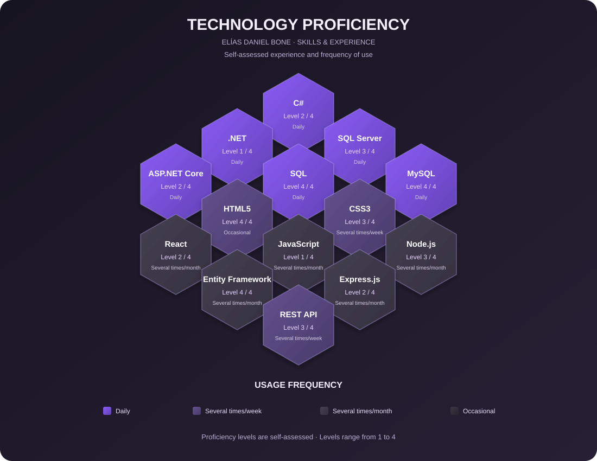

  

  <h3>Desarrollador de Software | Software Developer</h3>

  

    Diseño y desarrollo de soluciones tecnológicas facilitando la operativa empresarial.
     
    <em>Design and development of technological solutions facilitating business operations.</em>
  

  
  

---

## 👨‍💻 About me | Sobre mí

<table>
  <tr>
    <td width="70" align="center" valign="middle">
      <h3>🇪🇸 ES</h3>
    </td>
    <td>
      
Soy desarrollador de software con experiencia laboral en el desarrollo y mantenimiento de sistemas institucionales. Me enfoco en la construcción de aplicaciones web, soluciones backend, gestión de bases de datos e integración de servicios.

      
Me interesa desarrollar software funcional, organizado y mantenible, aplicando buenas prácticas de programación, patrones de arquitectura y herramientas que permitan construir soluciones eficientes.

      
Actualmente continúo fortaleciendo mis conocimientos en desarrollo Full Stack, especialmente en el ecosistema .NET, tecnologías web y diseño de bases de datos.

    </td>
  </tr>
  <tr>
    <td width="70" align="center" valign="middle">
      <h3>🇺🇸 EN</h3>
    </td>
    <td>
      
I'm a software developer with professional experience in institutional software development and maintenance. My work focuses on web applications, backend solutions, database management and service integration.

      
I'm interested in building functional, organized and maintainable software through programming best practices, architectural patterns and technologies that support efficient solutions.

      
I'm continuously expanding my Full Stack development skills, particularly in the .NET ecosystem, web technologies and database design.

    </td>
  </tr>
</table>

---

## 📓 Technical stack | Tecnologías

### ⚙️ Backend Development

  
  
  
  
  
  

### 🎨 Frontend Development

  
  
  
  
  
  

### 🗄️ Databases & Data Access

  
  
  
  
  

### 🏗️ Architecture & Software Engineering

  
  
  
  
  

### 📊 Reporting & Documents

  
  

### 🛠️ Development Tools

  
  
  
  
  

---

## 📈 Technology proficiency | Nivel de experiencia

My proficiency levels represent my personal assessment of practical knowledge. Usage frequency is a separate indicator and does not necessarily represent expertise.

Mis niveles representan una autoevaluación de mis conocimientos prácticos. La frecuencia de uso es un indicador independiente y no equivale necesariamente al dominio de una tecnología.

  

### 📈 Experience Scale | Escala de experiencia

Calculado automáticamente según los repositorios donde uso cada tecnología · 1/4 básico → 4/4 amplia experiencia

---

## 📖 Featured projects | Proyectos destacados

### TrendCast
#### Predictive Inventory Management System

A web application focused on inventory management for small and medium-sized businesses in the commercial sector.

**Key areas**
- Product, category and supplier management.
- Inventory control and stock movements.
- Minimum stock and reorder monitoring.
- Predictive analysis using Simple Moving Average and Simple Linear Regression.
- Reports and business-oriented data visualization.

  **Technology stack**

  `React` `TypeScript` `Node.js` `Express` `PostgreSQL` `Prisma`

### Institutional Software Development
#### Academic & Administrative Systems

Professional experience developing and maintaining institutional software solutions, contributing to the improvement of academic and administrative processes.

**Areas of work**
- Backend development with C# and ASP.NET MVC.
- Database queries, maintenance and optimization.
- Academic and administrative modules.
- Reports and document generation.
- Interface improvements and application maintenance.

  **Technology stack**

  `C#` `.NET` `ASP.NET MVC` `SQL Server` `JavaScript` `HTML5` `CSS3`

---

## 🌌 GitHub activity | Actividad en GitHub

  

   

  

---

## 📞 Contact | Contacto

**Open to software development opportunities, collaboration and new challenges.**
 
<i>Abierto a oportunidades de desarrollo de software, colaboración y nuevos desafíos.</i>

 

 

📧 elias.dbone.g@outlook.com

